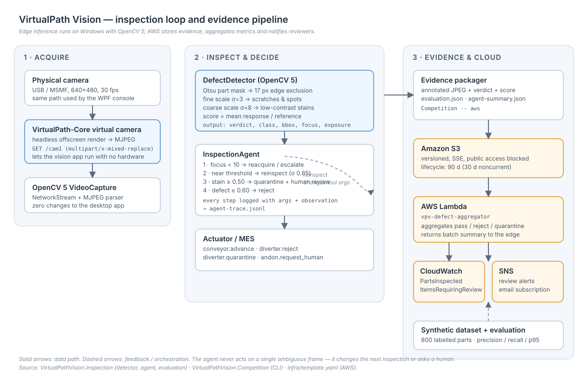
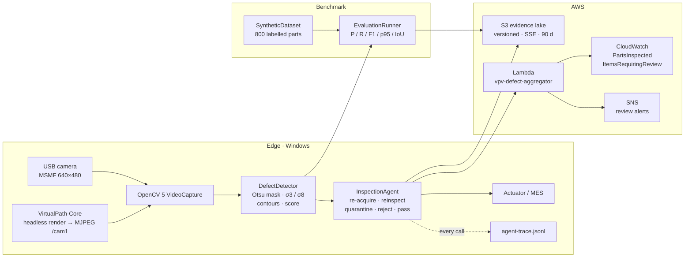

# Architecture



Editable source: [`architecture.svg`](architecture.svg). The Mermaid version below is the same graph in text form.



## Component contracts

| Component | Input | Output | Contract |
|---|---|---|---|
| `DefectDetector.Detect` | `Mat` (gray or BGR), `DetectorOptions` | `InspectionResult` | pure, no state, thread-safe |
| `InspectionAgent.Inspect` | part id, `Mat`, optional re-acquire callback | `AgentOutcome` | at most 2 inspect calls, at most 1 re-acquire |
| `ILineActuator.ApplyAsync` | `AgentOutcome` | command receipt | idempotent per part id |
| `EvaluationRunner.Run` | dataset dir + options | `EvaluationReport` | deterministic for a fixed dataset and options |
| `S3Service.UploadDetectionScreenshotAsync` | frame + mode | object key | key includes date and mode |

## Determinism

- Dataset: `seed = 20261026 + index × 7919`, per-sample `Random(seed)`; no wall-clock, no unordered iteration.
- Detector: fixed kernel sizes and thresholds derived only from `DetectorOptions`.
- Evaluation: single-threaded `foreach` over the label file order.
- Agent: fixed rule order; the only dynamic input is the frame.

Same code + same seed ⇒ identical `evaluation.json`. The checksum of the 800-image dataset is stable across runs; it is regenerated rather than committed.

## Data contracts

### `labels.jsonl`

```json
{"file":"images/0000.png","label":"good","bbox":null,"seed":20261026}
{"file":"images/0400.png","label":"scratch","bbox":[273,153,36,32],"seed":20577902}
```

### `agent-trace.jsonl`

One JSON object per part:

```json
{
  "partId": "P0401",
  "action": "Reject",
  "reasonCode": "confirmed_by_reinspection",
  "visionChangedAction": true,
  "totalMs": 18.782,
  "final": { "ng": true, "defect": "Stain", "score": 0.2927, "focus": 413.96 },
  "steps": [
    { "index": 0, "tool": "inspect", "args": { "sensitivity": 0.6, "contrastBoost": false }, "observation": "...", "reasonCode": null },
    { "index": 1, "tool": "inspect", "args": { "sensitivity": 0.85, "contrastBoost": true }, "observation": "...", "reasonCode": "ambiguous_defect" }
  ]
}
```

`reasonCode` values: `part_not_found`, `low_focus`, `image_unusable`, `near_threshold`, `ambiguous_defect`, `stain_requires_review`, `high_confidence_defect`, `confirmed_by_reinspection`, `cleared_by_reinspection`, `clean`.

### `agent-summary.json`

```json
{
  "total": 800,
  "byAction": { "Pass": 514, "Reject": 240, "Quarantine": 45, "Escalate": 1 },
  "byReason": { "clean": 469, "high_confidence_defect": 75, "stain_requires_review": 45,
                "confirmed_by_reinspection": 165, "cleared_by_reinspection": 45, "image_unusable": 1 },
  "visionChangedAction": 211,
  "agreementWithTruth": 0.855,
  "tracePath": "agent-trace.jsonl",
  "evidenceCount": 12
}
```

## Threading and lifetime

- Detection is synchronous and CPU-bound; the desktop app calls it from the capture thread, never from the UI thread.
- The agent's re-acquire callback is synchronous by design; a production integration would make it async and time-boxed.
- AWS uploads happen after the inspection loop, so cloud latency never blocks a conveyor decision.
- `S3Service` / `LambdaClient` are disposed by the CLI after the run; the WPF app keeps them for its lifetime.

## Failure containment

| Failure | Containment |
|---|---|
| Frame unreadable | agent escalates, no actuator action |
| No part found | agent re-acquires once, then escalates |
| Ambiguous score | re-inspection; second result decides |
| Cloud unavailable | upload failure is recorded in `aws-receipt.json`; local evidence remains |
| Lambda error | run still exits 0 after local artifacts are written (AWS step reports the error and writes an error receipt) |

## AWS well-architected notes

- **Security:** no credentials in code; bucket blocks public access, SSE at rest, IAM role scoped to `cloudwatch:PutMetricData`.
- **Cost:** 90-day expiry, 128 MB Lambda, no GPU, no always-on service.
- **Reliability:** S3 versioning; the edge keeps local artifacts so a cloud outage does not lose evidence.
- **Operational excellence:** CloudWatch metrics are the same counters the edge reports, so dashboards match the trace.
