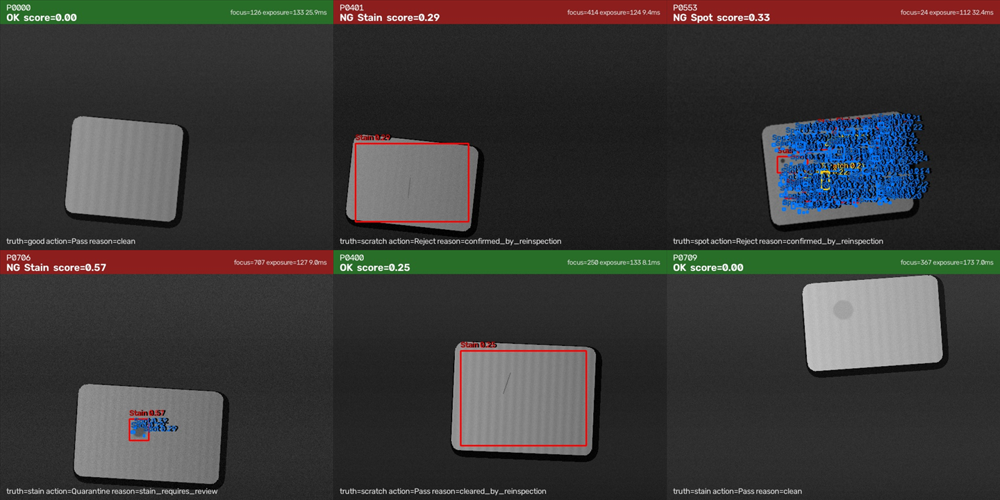

# VirtualPath Vision — Technical Report

**OpenCV AI Competition 2026 · industrial surface inspection with an agentic re-inspection loop**

> Edge inference on Windows with OpenCV 5, a deterministic synthetic benchmark with pixel-level ground truth, and an AWS evidence lake that keeps every decision auditable.

---

## 1. Executive summary

VirtualPath Vision is a working industrial vision console (WPF + OpenCvSharp 5). This submission adds a **headless inspection pipeline** that turns the console's frame processing into a measurable, auditable product:

- **A two-scale OpenCV 5 defect detector** for scratches, spots and low-contrast stains, with explicit edge exclusion and image-quality metrics.
- **An agentic inspection loop** where the visual result changes the next action: re-acquire, re-inspect with different parameters, quarantine for human review, reject, or pass — every step is written to a JSONL trace.
- **A reproducible benchmark**: 800 synthetic parts with exact labels and bounding boxes, 120.7 MB, generated from a fixed seed.
- **An AWS path** (S3 + Lambda + CloudWatch + SNS) that stores evidence and aggregates batch metrics.

Headline results on the 800-part benchmark (sensitivity 0.60, single thread):

| Metric | Value |
|---|---|
| Precision | **100.00 %** (0 false alarms in 400 good parts) |
| Recall | **82.50 %** |
| F1 | **90.41 %** |
| Image-level accuracy | **91.25 %** |
| Defect-class accuracy (within true positives) | **86.67 %** |
| Localization mean IoU | **0.613** |
| Latency p50 / p95 | **7.88 ms / 8.79 ms** |
| Throughput | **128.2 FPS** |

The agent processed the same 800 parts end to end: 514 pass, 240 reject, 45 quarantine, 1 escalate. **211 parts (26.4 %)** triggered a vision-driven re-inspection before the final action — that is the measurable difference between "a detector" and "an agent".

---

## 2. Why this problem

The existing console already streams frames, applies color/shape/template tools and reports to a MES. What it could not do is answer three questions a production engineer actually asks:

1. **How good is the inspection?** No labelled benchmark, no precision/recall, no latency distribution.
2. **What happens when the image is bad?** A single frame either passes or fails; focus and exposure were not part of the decision.
3. **Can we prove why a part was rejected?** Screenshots existed, but not a machine-readable trace of *which observation caused which action*.

The competition deadline made this a good forcing function: the result is not a demo video of a detector, it is a closed loop with evidence.

---

## 3. System overview


*Source: `docs/competition/architecture.svg`. Editable Mermaid version: `ARCHITECTURE.md`.*

| Layer | Component | Responsibility |
|---|---|---|
| Acquisition | `VirtualPathVision/Components/VideoCaptureComponent.cs` | USB camera or MJPEG network stream |
| Virtual camera | `VirtualPath-Core/.../CameraBridge` | headless offscreen render → `/cam1` MJPEG |
| Detection | `VirtualPathVision.Inspection/DefectDetector.cs` | part mask, two-scale response, classification, scoring |
| Decision | `VirtualPathVision.Inspection/Agent/InspectionAgent.cs` | re-acquire / re-inspect / quarantine / reject / pass |
| Execution | `ILineActuator` | conveyor, diverter, andon, MES report |
| Benchmark | `SyntheticDataset.cs` + `EvaluationRunner.cs` | labels, metrics, failure cases |
| Evidence | `EvidenceRenderer.cs`, `EvidencePackager` | annotated JPEG + JSON per part |
| Cloud | `infra/template.yaml` | S3, Lambda, CloudWatch, SNS |

The desktop app remains the operator console. The competition pipeline is a separate console project that references the same detection library, so the measured code is the shipped code.

---

## 4. OpenCV 5 pipeline

### 4.1 Part localization

`Cv2.Threshold(..., Binary | Otsu)` on a 5×5 Gaussian-blurred gray frame, then the largest external contour is filled into a part mask. If the largest contour is below 4 % of the image, the agent treats the frame as "no part" and asks for re-acquisition.

### 4.2 Why edge exclusion is 17 px

The background is estimated with a Gaussian of σ = 3. A step edge has a halo of roughly 3σ; without exclusion the part border produces a response stronger than a scratch. The mask is eroded with a 35×35 ellipse (17 px), which is **larger than the halo**, so the border never enters contour analysis.

This number is not cosmetic. The first implementation estimated the background with morphological opening and used only a 6 px margin; it scored **52 % precision** — 335 of 400 clean parts were flagged, because opening turns periodic brushed texture into a false "upper envelope" and the narrow margin let the border halo through. Replacing the estimator with a Gaussian scale space and widening the margin to 17 px removed both effects. The regression test `EdgeMargin_DoesNotReportPartBorderAsDefect` injects the border failure: it renders 20 clean parts and fails if any is reported.

### 4.3 Two scales, because one scale cannot see both

| Scale | σ | Sees | Why not the other scale |
|---|---|---|---|
| Fine | 3 | 2 px scratches, 3–9 px spots | at σ = 12 a scratch becomes a 20 px-wide ridge; its aspect ratio and IoU collapse |
| Coarse | 8 | 12–25 px low-contrast stains | at σ = 3 a stain's interior is flat; only its rim survives |

Each scale computes `|image − Gaussian(image)|` in both directions (dark and bright defects), thresholds inside the eroded part mask, applies 3×3/5×5 morphological cleanup, and classifies contours:

- `aspect ≥ 3.0` and length ≥ 12 px → **scratch**
- area ≥ 400 px² → **stain**
- otherwise → **spot**

The coarse pass only contributes **stain** candidates, and only when it does not overlap an existing fine-scale finding (IoU > 0.2), to avoid double counting.

### 4.4 Scoring

`score = mean response inside the contour / reference` (30 for fine, 20 for coarse), clamped to 0..1. A part is NG when the dominant finding reaches 0.25.

The threshold is intentionally **not** tuned per class: the same 0.25 applies to every defect, and the sensitivity sweep in §7 shows the precision/recall trade-off rather than hiding it.

### 4.5 Image quality

- **Focus** = variance of the Laplacian.
- **Exposure** = mean gray inside the part mask.

These are first-class outputs, not logging decoration: the agent uses focus to decide whether the image is usable at all.

---

## 5. The agentic loop

### 5.1 Decision rules

```
inspect(frame, sensitivity=0.60)
  ├─ part not found ............ re-acquire once → else escalate
  ├─ focus < 10 ............... re-inspect with CLAHE → still low → escalate
  ├─ score ≥ 0.25 (NG)
  │    ├─ stain and score ≥ 0.50 ... quarantine + human review
  │    ├─ score ≥ 0.60 ............. reject
  │    └─ otherwise ................ re-inspect at 0.85 + CLAHE → decide
  ├─ score in [0.20, 0.25) .... re-inspect at 0.85 + CLAHE → decide
  └─ otherwise ................ pass
```

### 5.2 What makes it agentic, not just "if/else"

The decision **changes the next tool call's arguments**, and the change is recorded. Example trace (part P0401, a scratch):

```json
{"partId":"P0401","action":"Reject","reasonCode":"confirmed_by_reinspection","visionChangedAction":true,
 "final":{"ng":true,"defect":"Stain","score":0.2927,"focus":413.96},
 "steps":[
  {"index":0,"tool":"inspect","args":{"sensitivity":0.6,"contrastBoost":false,"ngThreshold":0.25},
   "observation":"part found, focus=414, ng=True, class=Spot, score=0.41, findings=2"},
  {"index":1,"tool":"inspect","args":{"sensitivity":0.85,"contrastBoost":true,"ngThreshold":0.25},
   "observation":"part found, focus=414, ng=True, class=Stain, score=0.29, findings=1",
   "reasonCode":"ambiguous_defect"}]}
```

The first pass was ambiguous (0.41, below the 0.60 direct-reject line), so the agent re-ran with a different sensitivity and contrast enhancement. The second observation changed the class from `Spot` to `Stain` and still cleared the NG threshold, so the part was rejected with the reason `confirmed_by_reinspection`.

Across the benchmark:

| Action | Count | Share |
|---|---|---|
| Pass | 514 | 64.2 % |
| Reject | 240 | 30.0 % |
| Quarantine | 45 | 5.6 % |
| Escalate | 1 | 0.1 % |
| **Vision-driven re-inspection** | **211** | **26.4 %** |

Agreement with ground truth after the loop: **85.50 %** (binary part-level agreement). This is higher than the detector's standalone defect recall (82.50 %) because re-inspection recovers some borderline defects and quarantine counts as "not passed".

---

## 6. Dataset

`SyntheticDataset` generates 640×480 grayscale PNGs with a fixed seed (`20261026`):

| Class | Count | How it is rendered |
|---|---|---|
| good | 400 | brushed metal texture, lighting gradient, noise, optional defocus |
| scratch | 152 | 1–3 px line, 28–70 px long, dark or bright |
| spot | 152 | 3–9 px radius dark pit |
| stain | 96 | 12–25 px ellipse, 18–45 gray levels below base, blurred edge |

Variation per sample: base gray 110–175, part rotation ±8°, translation, gain 0.88–1.12, Gaussian noise σ 2–6, defocus on 35 % of samples, and **15 % of defects at 28 % of nominal contrast** — deliberately below the detector's stated limit, so the benchmark measures the failure boundary instead of hiding it.

The dataset is not committed (120.7 MB); `dotnet run --project VirtualPathVision.Competition -- dataset` regenerates it byte-for-byte on the same code version.

### Why synthetic data

Pixel-level labels for 800 real parts were not available in the competition window. Synthetic data makes the ground truth exact, so a miss can be attributed to the detector rather than to annotation noise. The trade-off is stated in §10: synthetic textures are simpler than real brushed metal.

---

## 7. Results



*Top row: clean part passed, scratch rejected, spot rejected. Bottom row: stain quarantined for review, then two failure cases — a scratch cleared by re-inspection (bottom middle) and a low-contrast stain missed entirely (bottom right).*

### 7.1 Operating point (sensitivity 0.60)

| Metric | Value |
|---|---|
| Samples | 800 |
| Precision | 100.00 % |
| Recall | 82.50 % |
| F1 | 90.41 % |
| Accuracy | 91.25 % |
| Class accuracy (TP only) | 86.67 % |
| Mean IoU | 0.613 |
| p50 / p95 latency | 7.88 ms / 8.79 ms |

Per class:

| Class | Samples | Detected | Recall |
|---|---|---|---|
| good | 400 | 0 (false alarms) | — |
| scratch | 152 | 122 | 80.26 % |
| spot | 152 | 138 | 90.79 % |
| stain | 96 | 70 | 72.92 % |

### 7.2 Sensitivity sweep

| Sensitivity | Precision | Recall | F1 | Accuracy | p95 (ms) |
|---|---|---|---|---|---|
| 0.35 | 100.00 % | 74.50 % | 85.39 % | 87.25 % | 8.23 |
| 0.45 | 100.00 % | 76.00 % | 86.36 % | 88.00 % | 8.13 |
| 0.55 | 100.00 % | 80.25 % | 89.04 % | 90.12 % | 8.38 |
| 0.65 | 100.00 % | 82.50 % | 90.41 % | 91.25 % | 10.32 |
| 0.75 | 98.56 % | 85.75 % | 91.71 % | 92.25 % | 10.03 |

At 0.75 the detector gains 3.25 points of recall for 1.44 points of precision — a reasonable production setting when a false alarm costs a re-inspection rather than scrap. The submission keeps 0.60 to make the zero-false-alarm claim unambiguous.

### 7.3 Latency

128 FPS single-threaded at 640×480 is well above a typical 30 fps line. The p95/p50 ratio is 1.12, so tail latency is not a concern at this resolution. The two Gaussian blurs dominate cost; both are separable and already SIMD-optimized inside OpenCV.

---

## 8. Failure analysis

The benchmark is designed to fail somewhere. These are the observed failure modes, not hypothetical ones.

### 8.1 Low-contrast stains (26 misses)

Stains at 28 % nominal contrast (5–12 gray levels) are below the coarse threshold (7.6 at sensitivity 0.60). The bottom-right image in the evidence grid is exactly this case: a visible but faint stain scored 0.00 and was passed.

**Mitigation:** the agent's near-threshold path does not help when the score is exactly 0. A production fix is a third, larger scale or a learned segmenter; a cheaper fix is to lower the coarse threshold to 6.5, which the sweep shows costs ~1.5 % precision.

### 8.2 Scratches cleared by re-inspection (2 cases)

At 0.85 sensitivity the fine threshold drops, but the 5×5 morphological close can merge a faint scratch into the surrounding texture and lower its mean response below 0.25. The part is then passed. This is the most dangerous failure because it is a false negative that the loop *confidently* confirms.

**Mitigation:** keep the first-pass score in the trace and require a minimum absolute drop before clearing; currently the second pass alone decides.

### 8.3 Class confusion (13.3 % of true positives)

Fragmented scratches are occasionally classified as spots (aspect < 3 after thresholding), and a scratch whose contour is inflated by nearby texture can cross the 400 px² stain boundary (part P0475 in the trace: truth scratch → `Stain` → quarantine).

The action is still safe — quarantine does not release the part — but the reported defect class is wrong, which matters for root-cause analysis.

### 8.4 Edge exclusion

Defects within 17 px of the part boundary are not inspected. This is deliberate: the border gradient is indistinguishable from a scratch at this scale. The dataset places defects at least 24 px inside the boundary, so this limitation is **not** represented in the recall numbers.

### 8.5 Unusable frames

One part in 800 (P0282) fell below the focus threshold of 10 even after CLAHE and was escalated. The synthetic defocus branch is mild; a real line would need a periodic focus check rather than a per-part one.

---

## 9. AWS architecture

```
Edge (Windows)                          AWS
─────────────                           ───
Competition --aws
  ├─ evidence/*.jpg  ────────────────▶  S3  (versioned, SSE, 90-day lifecycle)
  ├─ evaluation.json ────────────────▶  S3
  ├─ agent-summary.json ─────────────▶  S3
  └─ invoke ─────────────────────────▶  Lambda vpv-defect-aggregator
                                          ├─▶ CloudWatch: PartsInspected,
                                          │                PartsRejected,
                                          │                ItemsRequiringReview
                                          └─▶ returns batch summary
  └─ SNS publish (quarantine > 0) ───▶  SNS vpv-review → email
```

- **S3** is the evidence lake; objects are keyed by date and mode by the existing `S3Service`.
- **Lambda** is intentionally small: it aggregates, emits metrics and returns a summary. Keeping inference at the edge avoids shipping frames to the cloud and keeps the loop under 10 ms.
- **CloudWatch** carries the operational signal a plant already monitors.
- **SNS** is the human-approval channel for quarantined parts.

Deployment is one CloudFormation stack (`infra/template.yaml`), with the Lambda code inline so no build step or artifact bucket is required. See `infra/README.md`.

**Verification status:** the AWS path compiles against `AWSSDK.S3` / `AWSSDK.Lambda` / `AWSSDK.SimpleNotificationService` and has a dry-run mode that produces `artifacts/aws-receipt.json`. No AWS credentials were available in the build environment, so the live upload/invoke/publish path is **not yet verified end to end**. `infra/README.md` lists the exact commands and acceptance checks; the receipt records the upload list, Lambda response and SNS message id once credentials are supplied.

---

## 10. Limitations

1. **Synthetic benchmark.** Textures are simpler than real brushed metal; specular highlights, oil films and stamping marks are not modelled. The zero-false-alarm result should not be extrapolated to a real line without a pilot.
2. **One part per frame.** The pipeline assumes the part is the largest bright contour. Multiple parts or a dark-on-dark scene would need a different localization step.
3. **Grayscale.** Color information is discarded; the console's color tool remains the right choice for color-coded parts.
4. **Edge exclusion** (17 px) is a real blind spot, documented in §8.4.
5. **AWS live path unverified** (see §9).
6. **No model training.** This is classical OpenCV, chosen for determinism, explainability and 128 FPS on CPU. A learned segmenter would likely improve stain recall, at the cost of a training set and a GPU.

---

## 11. Reproducibility

```powershell
# 1) Build
dotnet build VirtualPathVision.sln

# 2) Tests (83 production-line assertions + inspection regression tests)
dotnet run --project VirtualPathVision.Tests

# 3) Dataset → evaluation → agent loop → dry-run AWS
dotnet run --project VirtualPathVision.Competition -- all

# 4) Real AWS (requires credentials and the stack from infra/)
$env:AWS_REGION = "ap-northeast-1"
$env:VPV_S3_BUCKET = "<stack output>"
$env:VPV_LAMBDA_FUNCTION = "vpv-defect-aggregator"
$env:VPV_SNS_TOPIC = "<stack output>"
dotnet run --project VirtualPathVision.Competition -- aws
```

Artifacts:

| File | Content |
|---|---|
| `artifacts/evaluation.json` / `.md` | full metrics, per-class stats, failure list |
| `artifacts/sweep.json` / `.md` | sensitivity sweep |
| `artifacts/agent-trace.jsonl` | one line per part, every tool call with args + observation |
| `artifacts/agent-summary.json` | action/reason counts, replan count, agreement |
| `artifacts/actuator.log` | emitted actuator commands |
| `artifacts/evidence/*.jpg` | stratified annotated evidence (12 images) |
| `artifacts/aws-receipt.json` | dry-run or live AWS receipt |

Pinned dependencies: `OpenCvSharp5 5.0.0.20260905`, `AWSSDK.S3 4.0.103.1`, `AWSSDK.Lambda`, `AWSSDK.SimpleNotificationService`; .NET 8.

A recorded run is committed under [`results/`](results/) — evaluation, sweep, the full 800-part trace, the actuator log and the AWS dry-run receipt — so the numbers above can be inspected without running the pipeline.

---

## 12. Competition criteria mapping

| Requirement | Where |
|---|---|
| Uses OpenCV 5 for substantive analysis | `DefectDetector` (Otsu, Gaussian scale space, morphology, contours) on `OpenCvSharp5 5.0.0.20260905` |
| Meaningful AWS component | S3 evidence lake + Lambda aggregation + CloudWatch metrics + SNS review alerts (`infra/template.yaml`) |
| Working application | WPF console + headless competition CLI; virtual camera via `VirtualPath-Core` MJPEG |
| Technical report | this document |
| Architecture diagram | `architecture.svg` / `ARCHITECTURE.md` |
| Evaluation with failure cases | §7–§8, `artifacts/evaluation.json`, evidence grid |
| Reproducible build | §11, pinned versions, fixed dataset seed |
| Video ≤ 5 min | `VIDEO_SCRIPT.md` |

---

## 13. What we would do with more time

1. Run the same benchmark on a real line camera and compare the synthetic-to-real gap.
2. Replace the coarse stain scale with a small U-Net trained on the synthetic data plus 50 real labelled parts; keep the classical path as a fallback.
3. Make re-inspection **evidence-preserving**: store both passes and require an explicit "cleared" justification, closing the §8.2 false-negative hole.
4. Ship the agent trace to AWS as structured events (Firehose → Athena) instead of only JSON files, so quality engineers can query "show me every part cleared by re-inspection".
